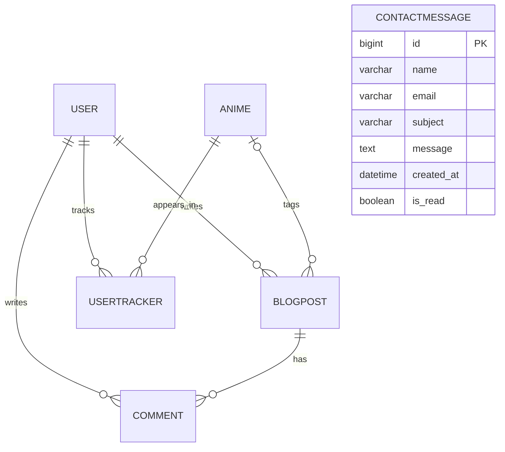
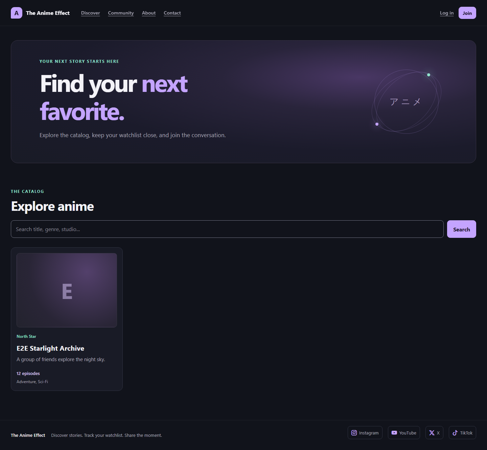
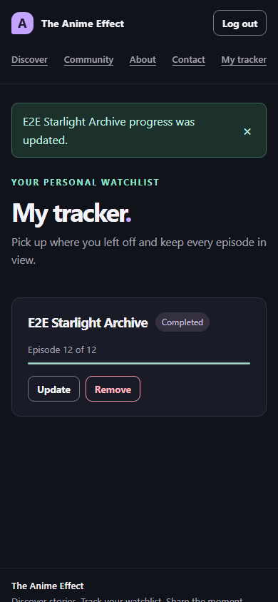
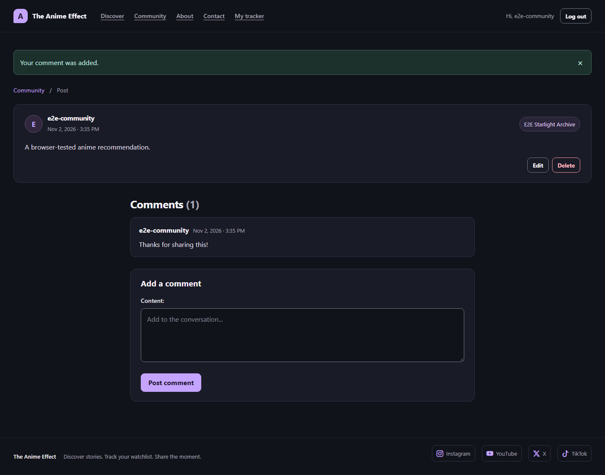
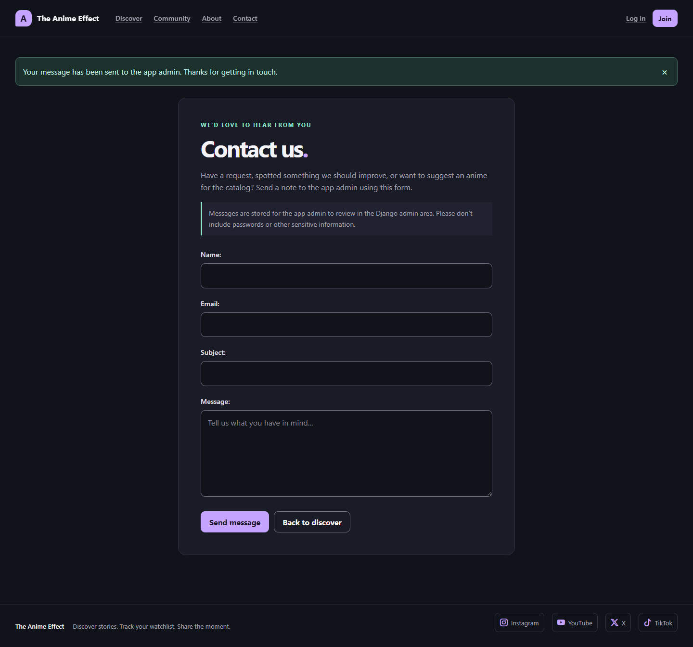
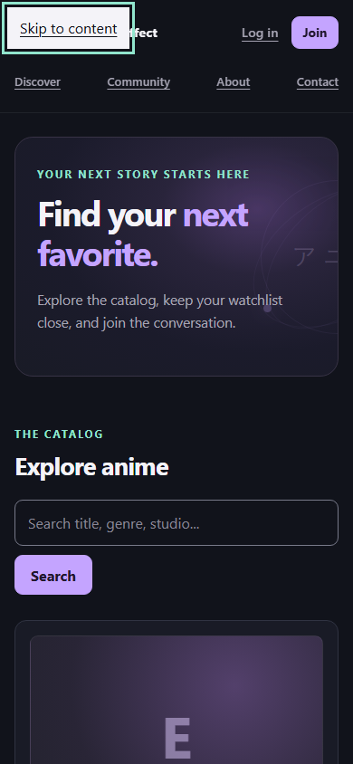
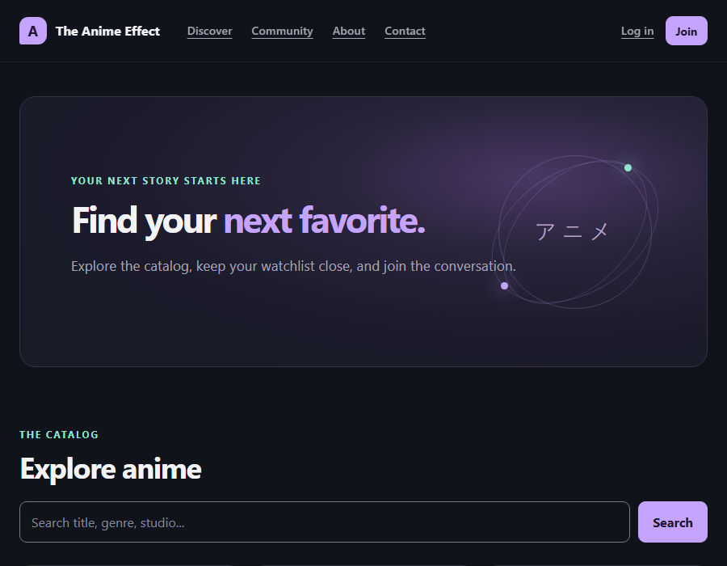
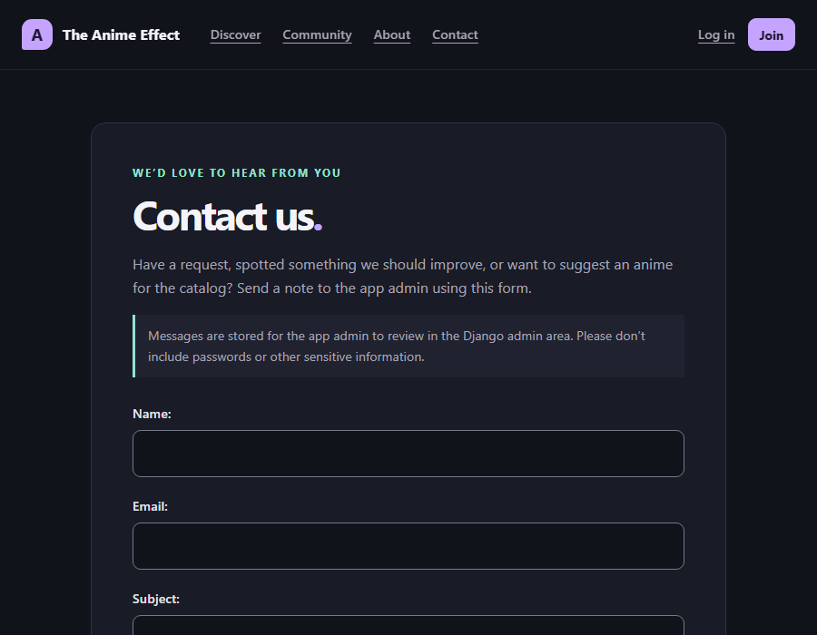

## 👤 About Me & Project Overview

Welcome to my Full-Stack Capstone project! I am an aspiring software engineer currently completing an intensive, AI-Augmented Full-Stack Bootcamp. This platform represents the culmination of my learning, combining a deep passion for the anime community with rigorous software engineering principles.

### 🚀 Project Vision
As an avid fan of animation, I wanted to build more than a static database. **My project is a responsive, full-stack anime platform that bridges content tracking with community engagement.** Users can browse an anime catalog, manage a personal watchlist, and share their thoughts with the community through a micro-blogging feed.

### 🛠️ Technical Focus & Learning Objectives
This application was engineered from scratch to demonstrate production-ready proficiency across several core pillars of full-stack development:
* **Agile Planning (LO1.3):** Built using an incremental, user-story-driven workflow. The [GitHub Projects board](https://github.com/users/manjnagra12-lgtm/projects/6) currently shows all 10 user stories in Done, with none in Backlog, Ready, In progress, or In review (checked 2 November 2026).
* **Robust Backend Architecture (LO1.2/2.1):** Powered by Django's ORM with a custom database schema, strict validation constraints, and relational data integrity.
* **Role-Based Access Control (LO3):** Implements secure, granular permissions differentiating standard users from site administrators to safeguard data modifications.
* **Accessibility-focused UX/UI Design (LO1.1):** Uses semantic templates, visible keyboard focus, labeled forms, and responsive CSS; accessibility checks and remaining limitations are documented below.
* **Reusable templates:** Shared page templates help keep the site’s layout and visual style consistent.

## User stories

### Epic 1: Accounts and Access Control

#### User Story 1: User Registration

> As a visitor, I want to create an account with a unique username, email, and password so that I can use the tracking and community features.

**Acceptance criteria:**
  - The registration form validates input, including matching passwords and valid email addresses.
  - The form labels its fields and displays helpful validation errors.
  - After registration, users are signed in and redirected to the home page.

#### User Story 2: Role-Based Login and State Reflection

> As a registered user, I want to log in securely so that I can access my personalized tracker and account navigation.

**Acceptance criteria:**
  - The navigation changes according to the user's sign-in state (``).
  - Signed-in users see a personalized greeting and links to My Tracker and Log out; signed-out visitors see Log in and Join.
  - Invalid login attempts display an accessible error without revealing sensitive security details.

#### User Story 3: Restricted Access Control

> As the site owner, I want to restrict protected actions to authorized users so that anonymous visitors cannot manage private data or publish content.

**Acceptance criteria:**
  - Unauthenticated users who try to access `/tracker/` or `/blog/create/` are redirected to sign in.
  - Non-staff users who try to manage the catalog receive an HTTP 403 Forbidden response.

### Epic 2: Anime Information and Directory (LO1 / LO2)


#### User Story 4: Browse and Search the Anime Database

> As a visitor, whether signed in or not, I want to browse a responsive anime catalog and open individual titles so that I can read their synopses, genres, and studio information.

**Acceptance criteria:**
  - The catalog uses semantic HTML and adapts to mobile, tablet, and desktop screens.
  - Text and background colors are checked for contrast; see the accessibility audit for results and limitations.
  - Selecting an anime opens a detail page with its available catalog information.

#### User Story 5: Admin Content Management

> As a staff user, I want to create, update, and delete catalog entries through the site or admin panel so that the catalog remains accurate.

**Acceptance criteria:**
  - Only staff users can create, edit, or delete catalog entries.
  - Database schema changes are managed with Django migrations.

### Epic 3: Personal Watchlist Tracking (LO2)


#### User Story 6: Add and Update Tracked Anime

> As a signed-in user, I want to add anime to my tracker, choose a watch status, and update episode progress so that I can keep an organized viewing history.

**Acceptance criteria:**
  - Users can add an anime from its detail page and choose a status: Plan to Watch, Watching, or Completed.
  - Validation prevents episode progress below 0 or above the anime's total episode count.
  - Changes are saved using Django's ORM.

#### User Story 7: View and Manage the Watchlist

> As a signed-in user, I want to view my tracker and remove entries when needed so that I can review my watchlist and correct mistakes.

**Acceptance criteria:**
  - My Tracker displays only the signed-in user's tracked titles.
  - A Remove action deletes the selected tracker entry after confirmation.
  - Successful removal displays a dismissible confirmation message.

### Epic 4: Community Posts and Comments (LO2)


#### User Story 8: Publish a Community Post

> As a signed-in user, I want to publish a post with an optional anime tag so that I can share my thoughts with the community.

**Acceptance criteria:**
  - The form rejects empty posts and text that exceeds the character limit.
  - Successful publication displays a notification.

#### User Story 9: View the Community Feed and Comment

> As a visitor, I want to read the community feed and open individual posts so that I can follow discussions; as a signed-in user, I also want to comment.

**Acceptance criteria:**
  - The feed displays posts from the database in reverse chronological order, including author, timestamp, content, and an optional anime link.
  - The responsive feed shows post-management actions only to the author.
  - Signed-in users can open a post's detail page and add a comment; visitors can read posts but must sign in to comment.

#### User Story 10: Edit and Delete Personal Posts

> As a post author, I want to edit or delete my posts so that I can correct or remove my contributions.

**Acceptance criteria:**
  - Edit and Delete actions are shown only to the post's author.
  - The server verifies ownership before allowing a post to be changed or deleted.


## ERD

The diagram reflects the current Django models and their foreign-key deletion rules. `ContactMessage` is intentionally independent: visitors can submit a request without creating an account.




### Detailed schema

The application uses Django's built-in `User` model and the following app models.

#### User (`django.contrib.auth`)

Django's built-in authentication model stores account and permission information. The registration form validates that email addresses are unique, although the `email` field itself is not a database-unique field.

| Field | Type | Constraints and notes |
| --- | --- | --- |
| `id` | Integer | Primary key |
| `username` | `CharField(150)` | Required and unique |
| `email` | `EmailField(254)` | Validated by the registration form; not database-unique |
| `is_staff` | Boolean | Defaults to `False`; controls staff access |

#### Anime (`catalog`)

Stores catalog entries. Catalog management is restricted to staff.

| Field | Type | Constraints and notes |
| --- | --- | --- |
| `id` | Integer | Primary key |
| `title` | `CharField(255)` | Required and indexed |
| `synopsis` | Text | Optional |
| `total_episodes` | Positive integer | Required; minimum 1, including a database check constraint |
| `genres` | `CharField(255)` | Optional |
| `studio` | `CharField(150)` | Optional |
| `image` | Image field | Optional; uploads are limited to 5 MB |

#### UserTracker (`tracker`)

Links a user to an anime entry and stores that user's watch status and progress.

| Field | Type | Constraints and notes |
| --- | --- | --- |
| `id` | Integer | Primary key |
| `user_id` | Foreign key | References `User`; cascades on user deletion |
| `anime_id` | Foreign key | References `Anime`; cascades on anime deletion |
| `status` | `CharField(20)` | Choices: Plan to Watch, Watching, or Completed |
| `current_episode` | Positive integer | Defaults to 0; form validation limits progress to the anime's episode total |

A unique constraint on (`user`, `anime`) prevents a user from adding the same anime more than once.

#### BlogPost (`social`)

Stores community posts, ordered newest first.

| Field | Type | Constraints and notes |
| --- | --- | --- |
| `id` | Integer | Primary key |
| `author_id` | Foreign key | References `User`; cascades on user deletion |
| `anime_id` | Foreign key | Optional reference to `Anime`; set to null if the anime is deleted |
| `content` | Text | Required; maximum 1,000 characters |
| `created_at` | Date/time | Set automatically when the post is created |

#### Comment (`social`)

Stores replies on posts, ordered oldest first. Deleting a post or its author also deletes their comments.

| Field | Type | Constraints and notes |
| --- | --- | --- |
| `id` | Integer | Primary key |
| `post_id` | Foreign key | References `BlogPost`; cascades on post deletion |
| `author_id` | Foreign key | References `User`; cascades on user deletion |
| `content` | Text | Required; maximum 1,000 characters |
| `created_at` | Date/time | Set automatically when the comment is created |

#### ContactMessage (`contact`)

Stores public requests and anime suggestions for staff to review in the Django admin. A user account is not required to submit a message.

| Field | Type | Constraints and notes |
| --- | --- | --- |
| `id` | Integer | Primary key |
| `name` | `CharField(100)` | Required |
| `email` | `EmailField(254)` | Required and validated |
| `subject` | `CharField(150)` | Required |
| `message` | Text | Required; maximum 3,000 characters |
| `created_at` | Date/time | Set automatically when the message is created |
| `is_read` | Boolean | Defaults to `False`; staff can mark the message as read |

## Running the project locally

The project uses Django with SQLite by default, so the database starts empty and you can enter your own records while testing. No sample accounts, anime, or posts are loaded automatically.

1. Create and activate a virtual environment, then install the pinned packages:

   ```powershell
   py -m venv .venv
   .\.venv\Scripts\Activate.ps1
   python -m pip install -r requirements.txt
   ```

2. Create your local, ignored environment file from the safe example:

   ```powershell
   Copy-Item .env.example .env
   ```

   `.env` is ignored by Git. The example contains only a development placeholder; replace it with a private key if you need one locally. Never put production secrets or real API credentials in `.env.example`.

3. Create the local database tables and an administrator account:

   ```powershell
   python manage.py migrate
   python manage.py createsuperuser
   ```

4. Start the development server and open `http://127.0.0.1:8000/`:

   ```powershell
   python manage.py runserver
   ```

Use `/admin/` to add anime records. Staff accounts can also add, edit, and delete catalog entries in the site UI. Public account registration is available from the navigation; registered users can maintain their own tracker and publish posts.

Staff can choose an optional cover image when adding or editing an anime. Images are validated as actual image files and limited to 5 MB; uploaded covers appear on the Explore anime cards and anime detail pages. Local uploads are stored under `media/` (ignored by Git). For a bundled fallback cover, keep the file in `static/images/` with the same basename as the catalog record's image filename; Django uses that static asset if the uploaded media file is missing. In production, configure persistent or object storage for uploaded media and serve it through the hosting platform; Django's development media route is enabled only with `DJANGO_DEBUG=True`.

## How to use the site

### First-time setup: add anime (staff)

The local database starts empty, so add a few catalog entries before trying the watchlist or tagging a post with an anime.

1. Sign in with the superuser account created during setup at `/accounts/login/`.
2. From the navigation, open **Admin**, or visit `/admin/` directly.
3. In the Django admin, open **Anime** and select **Add anime**. Alternatively, use **Add anime** on the Discover page.
4. Enter a title and total episode count. Add a synopsis, genres, and studio if available.
5. Optionally select a cover image. Keep the image at or below 5 MB and use a supported image format such as JPEG, PNG, GIF, or WebP.
6. Save the entry. It will appear in **Explore anime**; select its card to see the detail page.
7. To make changes later, open the anime and choose **Edit**. Staff can also delete an entry; deleting anime removes its tracker entries, while related blog posts remain and lose their anime link.

### Create an account and explore

1. Select **Join** in the navigation and enter a username, email address, and password. Email addresses must be unique.
2. Successful registration signs you in automatically. To return later, use **Log in** with your username and password.
3. On **Discover**, browse the anime cards or search by title, synopsis, genre, or studio. Use the page controls to move through a longer catalog.
4. Select an anime card to open its details, including the synopsis, episode count, studio, genres, and cover image when one is available.

### Manage your watchlist

1. While signed in, select **Add to my tracker** on an anime detail page.
2. Choose **Plan to Watch**, **Watching**, or **Completed**, then enter your current episode. Progress must be from 0 through that anime's total episode count.
3. Save to see the entry on **My tracker**. Each row shows its status and episode progress.
4. Select **Update** to change the status or episode count. Select **Remove** to remove the entry; confirm the browser prompt to proceed. Your tracker entries are private to your account.

### Read and write community posts

1. Open **Community** to read the newest posts. Posts may include a link to a related anime.
2. To post, sign in and choose **Write a post** (or **Join the conversation** if signed out).
3. Write up to 1,000 characters and optionally choose an anime to tag. Select **Publish post**.
4. Your own posts show **Edit** and **Delete** controls. Only the author can change or remove their post; deletion requires confirmation.
5. Use the feed's page controls to browse older posts.

### Sign out

Select **Log out** in the navigation when finished. You can sign in again at any time; your account's watchlist and posts remain saved.

### Environment configuration

The app loads `.env` for local development and reads deployment values from environment variables. Existing environment variables take precedence over values in `.env`.

| Variable | Purpose | Default |
| --- | --- | --- |
| `DJANGO_SECRET_KEY` or `SECRET_KEY` | Django signing key; required when debug is off and must be private | No production default |
| `DJANGO_DEBUG` | Enables Django debug mode when set to `true`, `1`, or `yes` | `False` |
| `DJANGO_ALLOWED_HOSTS` | Comma-separated hostnames | `localhost,127.0.0.1` |
| `CSRF_TRUSTED_ORIGINS` | Comma-separated trusted HTTPS origins; entries are normalized without trailing slashes | Heroku and Code Institute HTTPS subdomains |
| `DATABASE_URL` | PostgreSQL connection URL; required in production. PostgreSQL connections use SSL. | Local `db.sqlite3` |

Never commit `.env`, production credentials, or a production secret key. `.gitignore` excludes `.env`, `.env.*`, key files, and the `secrets/` directory; `.env.example` is the only environment-file exception and must contain placeholders only. Django refuses to start in production mode without `DJANGO_SECRET_KEY` or when the example placeholder is used. Set production secrets directly in the hosting provider's secret/environment settings, not in source files or browser JavaScript. If the application later uses an external API, read its key on the server from an environment variable (for example `os.environ["ANIME_PROVIDER_API_KEY"]`) and never render it into a template or static asset.

When `DJANGO_DEBUG=False`, Django enforces HTTPS redirects, secure session and CSRF cookies, and one-year HSTS for the app hostname and its subdomains. HSTS preloading is not enabled. Heroku terminates TLS before forwarding requests to Django; `SECURE_PROXY_SSL_HEADER` trusts Heroku's `X-Forwarded-Proto` header so HTTPS requests are not redirected repeatedly. These production settings are intentionally not controlled by optional environment flags. Keep the Heroku app on HTTPS and set `DJANGO_DEBUG=False`, `DJANGO_ALLOWED_HOSTS` to its hostname (without a scheme), `CSRF_TRUSTED_ORIGINS` to its HTTPS origin, and `DATABASE_URL` to its PostgreSQL database.

### UX and responsive design

The interface uses a consistent dark palette, visible keyboard focus, a skip link, semantic page landmarks, labeled forms, and responsive CSS Grid/Flexbox layouts. On narrow screens the catalog becomes a single-column list, navigation wraps, and tracker rows stack their progress and actions. On larger desktop displays, the content container expands and the catalog uses a four-column grid while keeping a readable maximum width. Reduced-motion preferences are respected. The catalog and community feed are paginated. Accessibility checks and known limits are documented in the [accessibility audit](docs/accessibility-audit.md); this review is not a certification of full WCAG conformance. The primary user flows are:

The following low-fidelity wireframes document the page structure and responsive intent. They describe layout rather than final visual styling.

**Shared site layout**

```text
DESKTOP
+------------------------------------------------------------------+
| A  The Anime Effect   Discover  Community  About  Contact   Join |
+------------------------------------------------------------------+
|                                                                  |
|                         PAGE CONTENT                             |
|                                                                  |
+------------------------------------------------------------------+
| The Anime Effect     Discover stories...     Instagram YouTube...|
+------------------------------------------------------------------+

MOBILE
+------------------------------+
| A  The Anime Effect    Join  |
| Discover  Community  About   |
| Contact                      |
+------------------------------+
|                              |
|         PAGE CONTENT         |
|                              |
+------------------------------+
| The Anime Effect             |
| Discover stories...          |
|             Instagram YouTube|
|                  X TikTok    |
+------------------------------+
```

**Discover catalog and anime detail**

```text
DISCOVER                              ANIME DETAIL
+--------------------------------+    +--------------------------------+
| Find your next favorite        |    | Discover / Anime title         |
| Explore the catalog...         |    | Anime title                    |
+--------------------------------+    | [Cover]                        |
| Search title, genre... [Search]|    | Episodes · Studio · Genres     |
+--------------------------------+    | Synopsis                       |
| [Anime card] [Anime card]      |    | [Add to my tracker]            |
| [Anime card] [Anime card]      |    +--------------------------------+
|        Previous  Page  Next    |
+--------------------------------+

On narrow screens, catalog cards stack into one column and detail
content stays in a single readable column.
```

**Tracker, community, and contact**

```text
MY TRACKER                           COMMUNITY
+--------------------------------+   +--------------------------------+
| My tracker                    |   | Currently discussing           |
| Anime title · Watching        |   | [Write a post]                 |
| Episode progress   [Update]   |   +--------------------------------+
|                   [Remove]    |   | Author · date · anime tag      |
| Anime title · Plan to Watch   |   | Post text                      |
| Episode progress   [Update]   |   | View comments                  |
+--------------------------------+   +--------------------------------+

CONTACT
+--------------------------------+
| Contact us                     |
| Request or anime suggestion    |
| Name                           |
| Email                          |
| Subject                        |
| Message                        |
| [Send message]                 |
+--------------------------------+
```

```text
Discover → Search/filter catalog → Anime details → Add/update tracker
Community → Read newest posts → Write/edit/delete your own post
Navigation → Register/log in → My tracker → Update or remove an entry
```

The implementation keeps the catalog and social feed public while gating tracker actions and content creation behind authentication. Only staff can manage the catalog, and post edits/deletes are scoped to their author.

The shared header/navigation, page-specific content area, and footer provide a consistent structure. Catalog pages use a search bar followed by a responsive card grid; detail pages place show metadata and synopsis above a single tracker action; tracker pages put each title, status, progress bar, and controls together; community pages use stacked post cards with author/time metadata. The mobile adaptation keeps the same content order, wraps navigation, and stacks cards and tracker actions rather than hiding functionality. During implementation, the catalog and feed were paginated to keep longer manually entered datasets manageable.

### Tests

Run the automated test suite with:

```powershell
python manage.py test
```

The current automated suite contains **29 Django tests**, verified with:

```text
Ran 29 tests
OK
System check identified no issues
```

Coverage includes:

- Account registration, login/logout, and duplicate email validation.
- Catalog search and detail pages, staff-only anime create/edit/delete, cover uploads, and fallback to a bundled cover when an uploaded image is unavailable.
- Tracker privacy, status/progress validation, and episode limits.
- Community feed and post details, authenticated comment creation, comment length validation, post creation and length validation, and author-only post editing/deletion.
- Contact form rendering, submission and validation, and staff access to the admin inbox.
- About page content and shared social media links.

The test suite verifies application behavior; it does not replace manual browser checks for accessibility and responsive behavior.

#### Accessibility audit

The [accessibility audit report](docs/accessibility-audit.md) records the automated scan, keyboard and form checks, contrast measurements, and areas that still need assistive-technology testing. On 2 November 2026, axe-core 4.10.3 reported zero violations for WCAG 2.0/2.1 A and AA rules across seven representative public pages in local Chromium. This is useful evidence, not proof that every criterion or authenticated state conforms.

#### End-to-end browser tests

The optional Playwright suite runs the application on Django's live test server with an isolated test database. It exercises the interface in Chromium and verifies persisted results; the browser is not included in production dependencies.

Install the development dependencies and Chromium once:

```powershell
python -m pip install -r requirements-dev.txt
python -m playwright install chromium
```

Run the browser tests:

```powershell
python manage.py test e2e_tests.browser_flows
```

To also capture the test screenshots used below, set the screenshot directory before running the suite:

```powershell
$env:E2E_SCREENSHOT_DIR = "docs/screenshots/e2e"
python manage.py test e2e_tests.browser_flows
Remove-Item Env:E2E_SCREENSHOT_DIR
```

The four browser tests cover:

- Account registration followed by adding, updating, and removing a tracker entry; cancelling the removal keeps the entry.
- Publishing a community post, dismissing its success notification, and adding a comment.
- Checking invalid-email browser validation, then submitting a valid contact request and verifying it reaches the admin inbox.
- Keyboard access to the skip link and horizontal-overflow checks on seven public page types at 320, 390, 768, and 1,280 CSS-pixel viewport widths. The signed-in tracker and post-detail/comment flows are also checked at those widths.

The standard Django suite remains separate at 29 tests; the optional browser suite has four tests and is run explicitly with the command above.

Screenshots are opt-in and are written to the directory named by `E2E_SCREENSHOT_DIR`. The screenshots shown here were captured from the local test server using the isolated test database; they are illustrative browser-test evidence, not screenshots of the deployed site or evidence of production data.

**Discover page — desktop browser test**



**Tracker — mobile browser test**



**Community post and comment**



**Contact request submitted**



**Discover page — mobile browser test**



Recorded browser-check results (including JavaScript interactions):

| Check | Result |
| --- | --- |
| Resize Discover, anime detail, About, Contact, Community, Log in, and Register pages to 320, 390, 768, and 1,280 CSS-pixel viewport widths | **Pass** — no document-level horizontal overflow in the Playwright browser checks |
| Resize the signed-in tracker and post-detail/comment flow to the same viewport widths | **Pass** — no document-level horizontal overflow in the Playwright browser checks |
| Press Tab from the top of Discover | **Pass** — focus reaches the skip link, which targets `#main-content` |
| Dismiss tracker and post-publication success notifications | **Pass** — the selected notification is removed from the page |
| Cancel and then confirm tracker removal | **Pass** — cancelling leaves the entry visible; confirming removes it |
| Submit an invalid contact email, then a valid request | **Pass** — browser email validation blocks the invalid value; the valid request is saved to the admin inbox |
| Validate episode limits, post length, and author-only editing/deletion | **Pass** — covered by the standard Django test suite; these checks are not represented as browser tests |
| Exercise normal form labels and automated accessibility rules on the seven audited public page types | **Pass with limitations** — see the [accessibility audit](docs/accessibility-audit.md) for axe results and incomplete checks |

These are recorded automated browser and Django test outcomes, not a claim that every interaction has been manually tested. Screen-reader operation and 200% browser zoom/text resizing remain outstanding manual checks; responsive viewport measurements do not substitute for either.

#### Manual browser screenshots

The following desktop screenshots were captured from the deployed site on 2 November 2026 during visual browser checks. The mobile layout was separately checked at 320, 390, 768, and 1,280 CSS-pixel viewport widths; no horizontal page overflow was detected. These desktop images document page appearance only and do not represent successful form submissions or authenticated tracker actions.

**Discover page — desktop viewport (900 × 700)**



**Contact page — desktop viewport (900 × 700)**



### Deployment

The production site is hosted on Heroku. These steps deploy the current Git branch through the Heroku Git CLI. Heroku's release phase in `Procfile` runs migrations before the new web release starts.

1. Install the [Heroku CLI](https://devcenter.heroku.com/articles/heroku-cli), sign in with `heroku login`, and set the app name in PowerShell:

   ```powershell
   $appName = "your-heroku-app-name"
   $appHost = "$appName.herokuapp.com"
   ```

   Confirm the app has a PostgreSQL database attached. The app requires `DATABASE_URL` and refuses to start in production without it. If no database is attached, select a suitable Heroku Postgres plan and create it with `heroku addons:create heroku-postgresql:essential-0 --app $appName`; check the plan and billing before creating an add-on.
2. Configure the non-secret environment values:

   ```powershell
   heroku config:set DJANGO_DEBUG=False "DJANGO_ALLOWED_HOSTS=$appHost" "CSRF_TRUSTED_ORIGINS=https://$appHost" --app $appName
   ```

   If the app uses a custom domain, include that hostname in `DJANGO_ALLOWED_HOSTS` and its `https://` origin in `CSRF_TRUSTED_ORIGINS`.
3. Generate and set a private signing key. Do not put its value in the repository or README:

   ```powershell
   $secret = python -c "import secrets; print(secrets.token_urlsafe(64))"
   heroku config:set "DJANGO_SECRET_KEY=$secret" --app $appName
   Remove-Variable secret
   ```

4. Ensure the Heroku Git remote is configured, then deploy the current branch:

   ```powershell
   heroku git:remote --app $appName
   git push heroku HEAD:main
   ```

5. Verify the release and production settings:

   ```powershell
   heroku config:get DJANGO_DEBUG --app $appName
   heroku config:get DJANGO_ALLOWED_HOSTS --app $appName
   heroku run python manage.py check --deploy --app $appName
   curl.exe -sSI "http://$appHost"
   curl.exe -sS -D - -o NUL "https://$appHost/contact/"
   ```

   The plain-HTTP request should redirect to HTTPS. The HTTPS response should include `Strict-Transport-Security`; the Contact page's CSRF cookie and an authenticated session cookie should include the `Secure` attribute. A `security.W021` deployment-check warning about HSTS preload is expected: preload is intentionally disabled for the Heroku hostname. Check the release output for successful migrations and open the HTTPS site to smoke-test the catalog, registration/login, tracker, community, and contact flows. A deployment is not verified until these checks have been run against the newly released version.

### AI-assisted development reflection

I used the built-in Copilot to support the development of this application, including establishing its structure, refining the user experience, and identifying accessibility improvements informed by WCAG guidance. Copilot also helped me write and run automated tests, investigate bugs, and work through technical issues as I developed and scoped the project.

I encountered several critical errors during development and had to restart the project more than once. Copilot helped me understand and resolve these challenges, and supported me in completing the application on time and to the standard I was aiming for. I reviewed and tested the resulting work as part of the development process.

Because of time constraints and development challenges, I relied heavily on Copilot while building the blog and comments features with Django. Its step-by-step explanations helped me understand the implementation and add these features to the project.

One specific example of this assistance was building browser-test journeys for registration and watchlist updates, community posts and comments, and contact requests. I reviewed the test flows and extended them to check that dismissing a success notification removes it, cancelling a tracker deletion preserves the entry, and confirming the deletion removes it. I also extended the responsive checks across public pages and signed-in tracker/comment pages. The current optional Playwright suite passes all four browser tests, while the separate Django suite verifies model, form, and permission behavior. This testing helped me check Copilot-assisted work against observable results rather than relying on generated code alone.

### Considerations for next updates

- **Improve contact request handling:** Add optional email notifications for staff and an acknowledgement for the sender. Add rate limiting or spam protection before enabling email delivery.
- **Add community moderation tools:** Let staff review or remove inappropriate posts and comments, and give users a way to report content.
- **Expand account support:** Add password-reset and email-verification flows, with clear guidance for users who lose access to their account.
- **Strengthen accessibility verification:** Continue page-by-page keyboard and screen-reader testing, check text and control contrast, and add automated accessibility checks to the development workflow.
- **Expand end-to-end coverage:** Add browser checks for invalid form submissions, logged-out restrictions, and other accessibility interactions as the application evolves.
- **Use durable production media storage:** Store uploaded anime covers in persistent object storage so they remain available across deployments and dyno restarts.


## Special notes

- Some anime cover images originate from online sources.
- Copilot's assistance with development and testing is acknowledged in the reflection above.